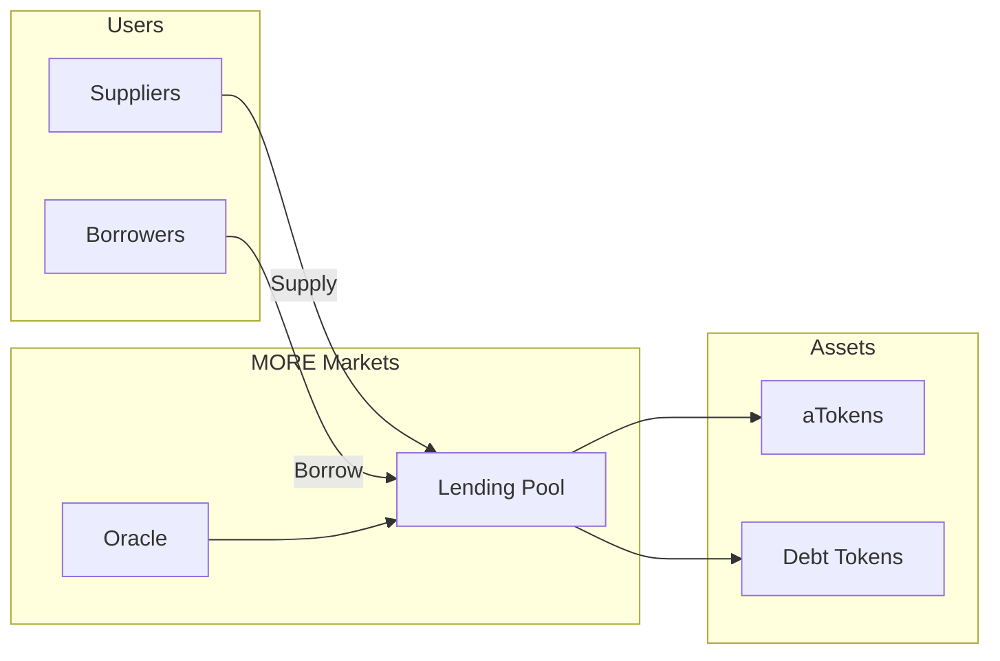

# MORE Markets

A decentralized non-custodial liquidity protocol built on Aave V3, deployed on Flow EVM.



## Overview

MORE Markets enables users to:
- **Supply** digital assets to earn interest
- **Borrow** against collateral at variable rates
- **Liquidate** undercollateralized positions

The protocol is deployed on **Flow EVM Mainnet** with 9 supported markets.

## Documentation

| Document | Description |
|----------|-------------|
| [Deployed Contracts](./docs/DEPLOYED_CONTRACTS.md) | All contract addresses by network |
| [Markets Configuration](./docs/MARKETS_CONFIGURATION.md) | Risk parameters for each market |
| [Architecture](./docs/ARCHITECTURE.md) | Protocol architecture and diagrams |

## Supported Markets

| Asset | Type | LTV | Liq. Threshold | Status |
|-------|------|-----|----------------|--------|
| WFLOW | Native | 81.50% | 83.00% | Active |
| ankrFLOW | LST | 78.50% | 81.00% | Active |
| WETH | Bridge | 80.00% | 83.00% | Active |
| WBTC | Bridge | 73.00% | 78.00% | Frozen |
| cbBTC | Bridge | 73.00% | 78.00% | Frozen |
| USDF | Stablecoin | 75.00% | 79.25% | Active |
| stgUSDC | Stablecoin | 75.00% | 78.00% | Active |
| PYUSD0 | Stablecoin | 75.00% | 78.00% | Active |

## Key Addresses (Flow EVM)

| Contract | Address |
|----------|---------|
| Pool | [`0xbC92aaC2DBBF42215248B5688eB3D3d2b32F2c8d`](https://evm.flowscan.io/address/0xbC92aaC2DBBF42215248B5688eB3D3d2b32F2c8d) |
| PoolDataProvider | [`0x79e71e3c0EDF2B88b0aB38E9A1eF0F6a230e56bf`](https://evm.flowscan.io/address/0x79e71e3c0EDF2B88b0aB38E9A1eF0F6a230e56bf) |
| Oracle | [`0x7287f12c268d7Dff22AAa5c2AA242D7640041cB1`](https://evm.flowscan.io/address/0x7287f12c268d7Dff22AAa5c2AA242D7640041cB1) |
| PoolAddressesProvider | [`0x1830a96466d1d108935865c75B0a9548681Cfd9A`](https://evm.flowscan.io/address/0x1830a96466d1d108935865c75B0a9548681Cfd9A) |

See [Deployed Contracts](./docs/DEPLOYED_CONTRACTS.md) for the complete list.

## Audits

All audit reports are available in the [`audits/`](./audits/) directory.

### Aave V3 (Base Protocol)

| Auditor | Date | Report |
|---------|------|--------|
| ABDK | January 2022 | [View](./audits/Aave/27-01-2022_ABDK_AaveV3.pdf) |
| OpenZeppelin | November 2021 | [View](./audits/Aave/01-11-2021_OpenZeppelin_AaveV3.pdf) |
| Trail of Bits | January 2022 | [View](./audits/Aave/07-01-2022_TrailOfBits_AaveV3.pdf) |
| PeckShield | January 2022 | [View](./audits/Aave/14-01-2022_PeckShield_AaveV3.pdf) |
| SigmaPrime | January 2022 | [View](./audits/Aave/27-01-2022_SigmaPrime_AaveV3.pdf) |
| Certora | January 2022 | [View](./certora/Aave_V3_Formal_Verification_Report_Jan2022.pdf) |
| PeckShield (V3.0.1) | December 2022 | [View](./audits/Aave/09-12-2022_PeckShield_AaveV3-0-1.pdf) |
| SigmaPrime (V3.0.1) | December 2022 | [View](./audits/Aave/23-12-2022_SigmaPrime_AaveV3-0-1.pdf) |

### MORE Markets

| Auditor | Date | Report |
|---------|------|--------|
| PeckShield | December 2024 | [View](./audits/MORE/PeckShield-Audit-Report-MOREMarkets-v1.0.pdf) |
| Zenith | January 2025 | [View](./audits/MORE/MORE%20Markets%20-%20Zenith%20Audit%20Report.pdf) |

## Integration

### Installation

```bash
npm install @more-labs/more-markets
```

### Solidity

```solidity
import {IPool} from "@more-labs/more-markets/contracts/interfaces/IPool.sol";

contract Integration {
    IPool public constant POOL = IPool(0xbC92aaC2DBBF42215248B5688eB3D3d2b32F2c8d);

    function supply(address asset, uint256 amount) external {
        IERC20(asset).approve(address(POOL), amount);
        POOL.supply(asset, amount, msg.sender, 0);
    }

    function borrow(address asset, uint256 amount) external {
        POOL.borrow(asset, amount, 2, 0, msg.sender);
    }
}
```

### JavaScript

```javascript
const PoolArtifact = require('@more-labs/more-markets/artifacts/contracts/protocol/pool/Pool.sol/Pool.json');

const pool = new ethers.Contract(
    '0xbC92aaC2DBBF42215248B5688eB3D3d2b32F2c8d',
    PoolArtifact.abi,
    signer
);
```

## Development

### Prerequisites

- Docker and Docker Compose
- Node.js 16+

### Setup

1. Clone the repository:
```bash
git clone https://github.com/MOREProtocol/MORE-Markets.git
cd MORE-Markets
```

2. Create environment file:
```bash
cp .env.example .env
# Add your ALCHEMY_KEY or INFURA_KEY
```

3. Start development environment:
```bash
docker-compose up -d
docker-compose exec contracts-env bash
```

### Commands

| Command | Description |
|---------|-------------|
| `npm run compile` | Compile contracts |
| `npm run test` | Run test suite |
| `npm run coverage` | Generate coverage report |

## Network Information

### Flow EVM Mainnet

| Parameter | Value |
|-----------|-------|
| Chain ID | 747 |
| RPC | https://mainnet.evm.nodes.onflow.org |
| Explorer | https://evm.flowscan.io |
| Native Token | FLOW |

## License

This project is licensed under the BUSL-1.1 license. See [LICENSE](./LICENSE) for details.
