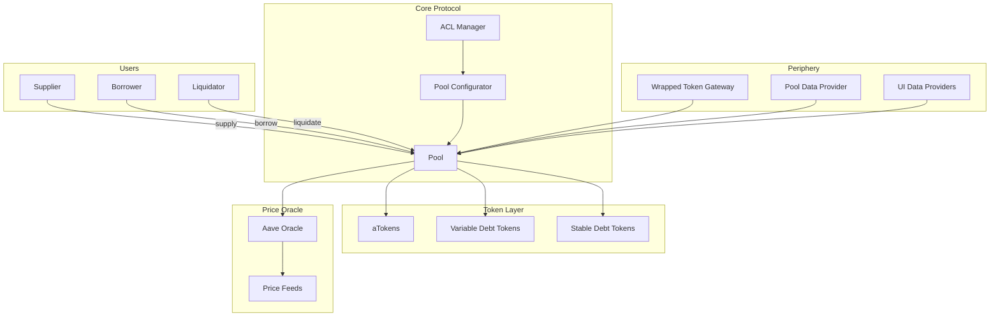
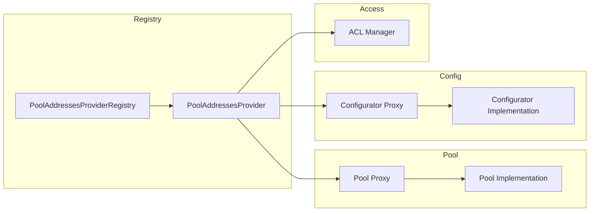
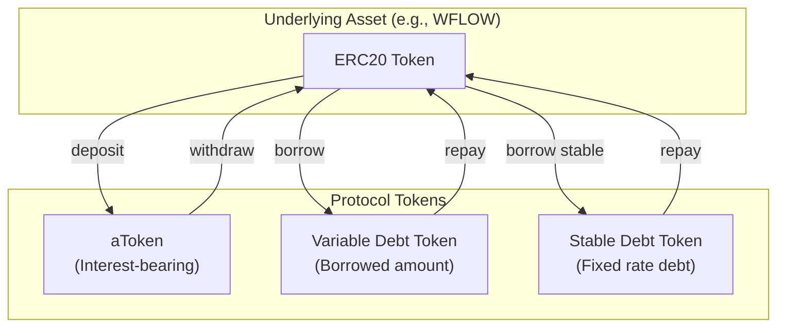
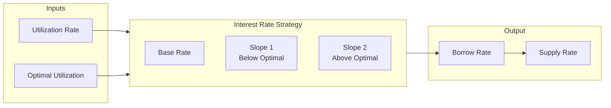
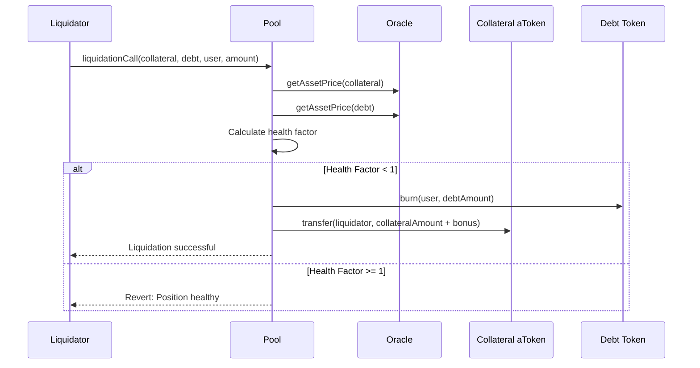
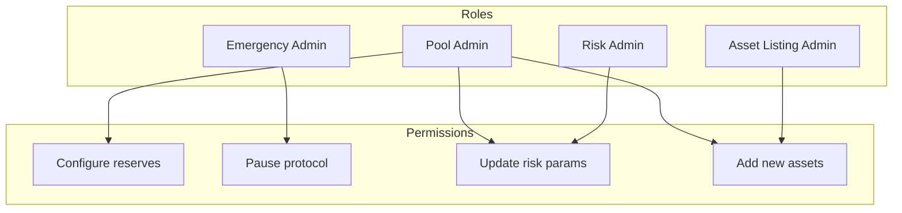
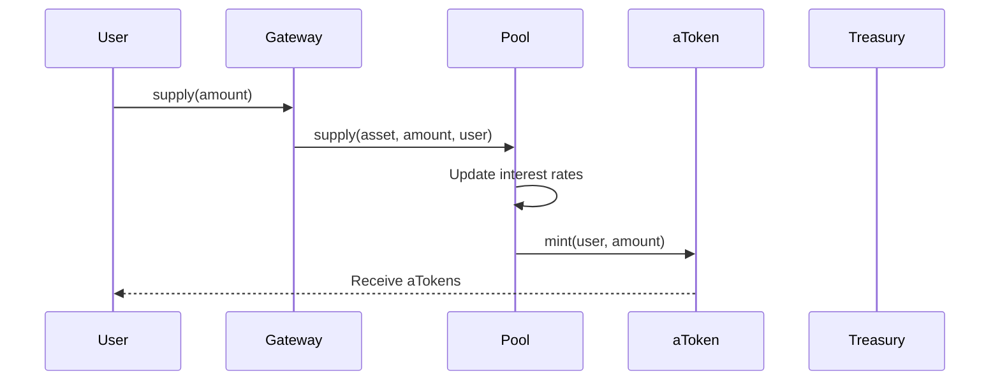
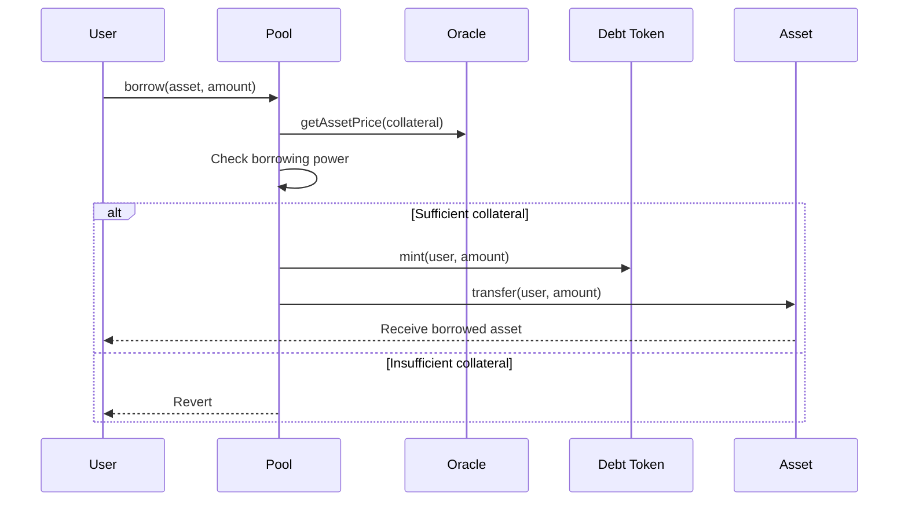
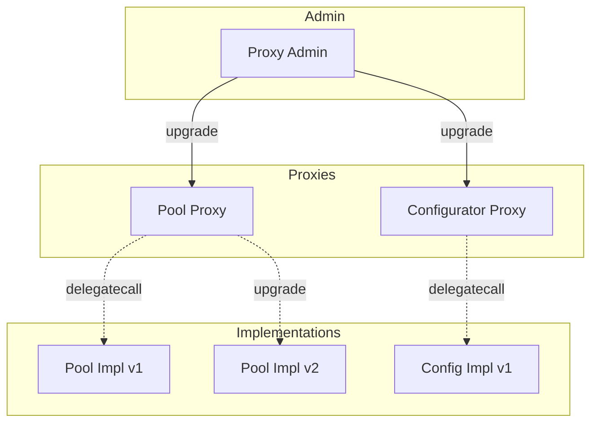
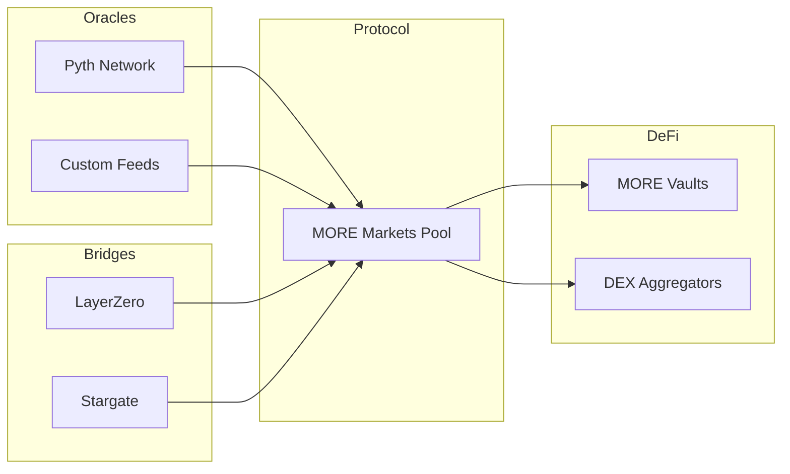

# Architecture

This document provides an overview of the MORE Markets protocol architecture.

## Protocol Overview

MORE Markets is a decentralized liquidity protocol built on the Aave V3 architecture, deployed on Flow EVM. The protocol enables permissionless lending and borrowing of digital assets.

## Contract Architecture

### Core Contracts

### Token Architecture

For each supported asset, the protocol deploys three token contracts:

## Interest Rate Model

The protocol uses a variable interest rate model based on utilization:

**Rate Calculation:**
- When Utilization <= Optimal: `Rate = Base + (Utilization / Optimal) * Slope1`
- When Utilization > Optimal: `Rate = Base + Slope1 + ((Utilization - Optimal) / (1 - Optimal)) * Slope2`

## Liquidation Flow

## Access Control

## Data Flow

### Supply Operation

### Borrow Operation

## Upgradability

The protocol uses a proxy pattern for upgradability:

## External Integrations

